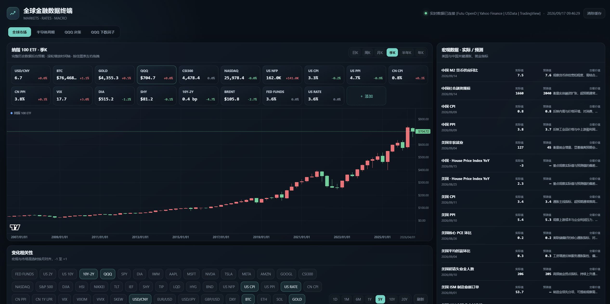
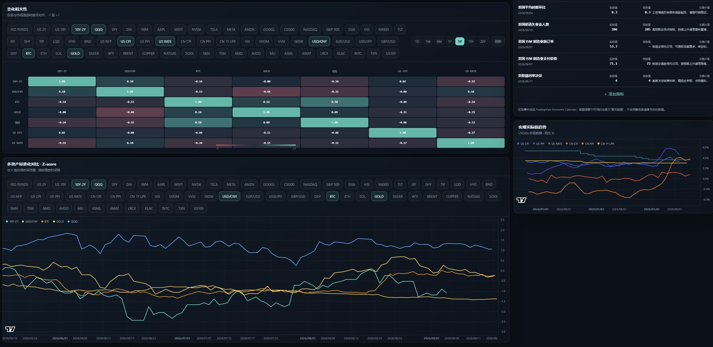
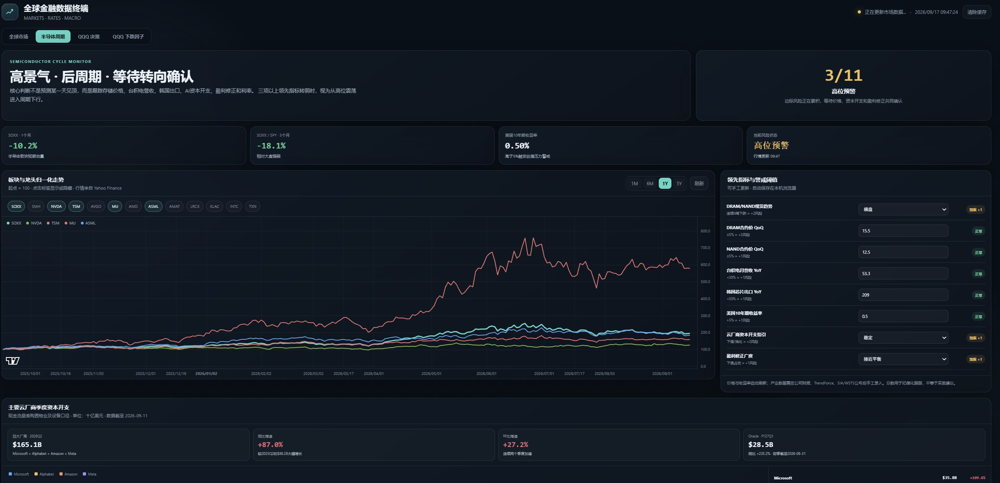
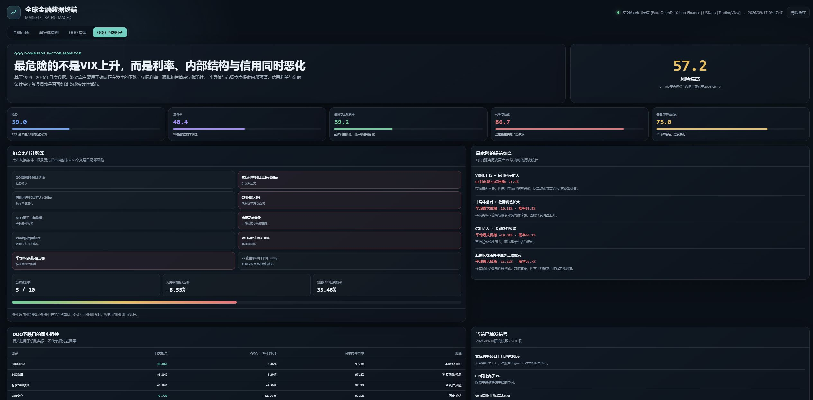

# Global Finance Dashboard

A local financial dashboard for monitoring global markets, macro trends, semiconductor cycles, and QQQ downside risk.

## Screenshots

| Semiconductor Cycle | Macro & Correlation |
|---|---|
|  |  |

| Global Markets | QQQ Downside Factors |
|---|---|
|  |  |

## Run

### Electron desktop app

Requires Node.js, Python 3.11 or newer, and [uv](https://docs.astral.sh/uv/).

```powershell
cd dashboard
npm install
npm start
```

On Windows, you can also double-click `打开金融仪表盘 Electron.cmd`. The
Electron process starts the local Python API on an available random port and
stops it when the desktop app exits. The launcher keeps a runtime copy under
`%LOCALAPPDATA%\FinanceDashboard` so the Windows Electron sandbox can access
its binaries even when the repository has restricted development-folder ACLs.

### Browser

```powershell
uv run python dashboard/dashboard_server.py
```

The dashboard opens automatically at `http://localhost:8765`.

## IPO calendar

The `IPO 日历` tab shows the last 5 years of IPO proceeds for A-shares
(AKShare `stock_xgsglb_em`), Hong Kong (Eastmoney `hk.eastmoney.com/ipolist`)
and the US (Nasdaq IPO calendar API), aggregated by day or month in local
currency (亿). `/api/ipo?market=a|hk|us` caches each market for 6 hours.

## Market time axis

Market and multi-asset comparison charts use an equally spaced UTC calendar-day
axis, including weekends, holidays, and dates without macro releases. Missing
dates contain no synthetic prices. Daily observations are grouped by UTC date;
weekly and longer candles retain the same daily axis.

Switching assets or candle periods, refreshing data, and loading additional
history preserve the current zoom and pan window, including fractional-day
positions. The initial window is the last calendar year, independent of the
selected asset's data coverage.

The offline browser regression test uses Puppeteer from the `lightweight-charts`
development dependencies. With a system Chrome installation on Windows:

```powershell
$env:PUPPETEER_EXECUTABLE_PATH = 'C:\Program Files\Google\Chrome\Application\chrome.exe'
node --test .\dashboard\test_market_time_axis.cjs
```
