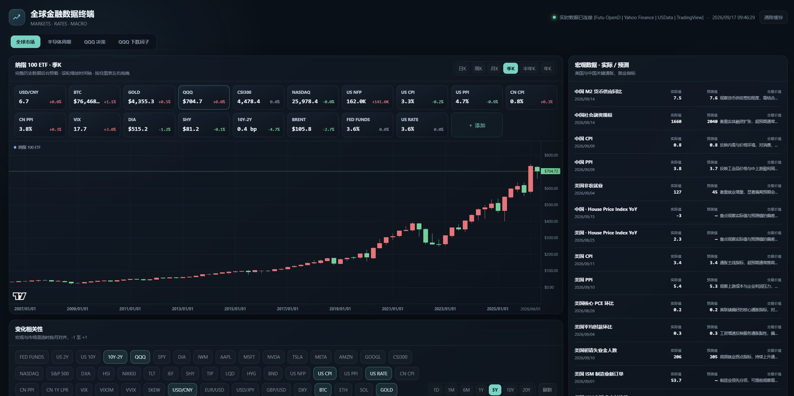
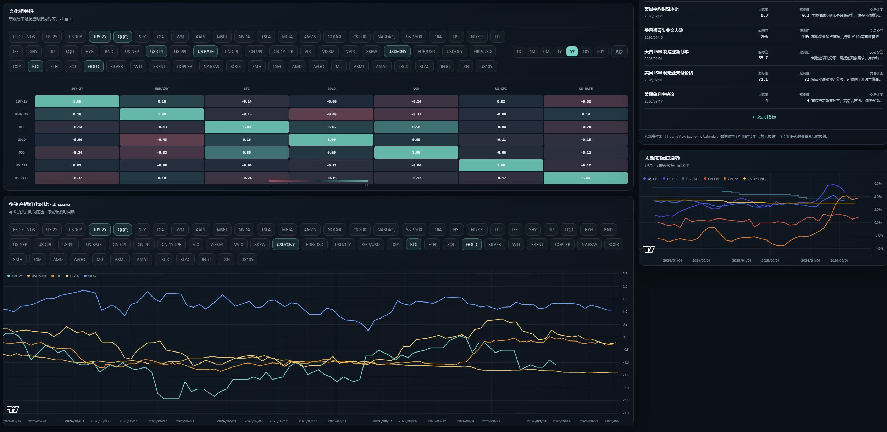
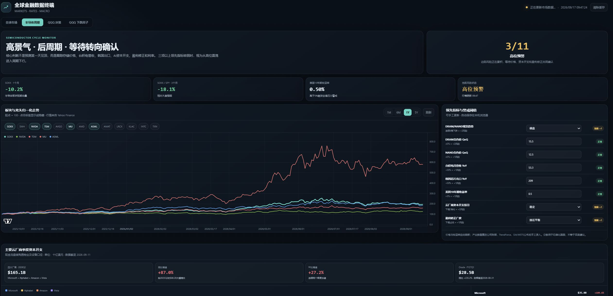
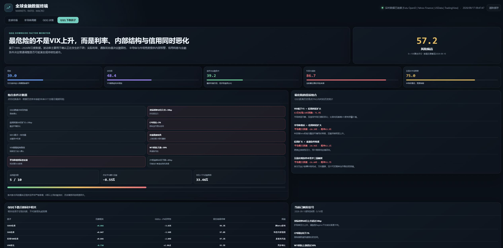

# Global Finance Dashboard

A local financial dashboard for monitoring global markets, macro trends, semiconductor cycles, and QQQ downside risk.

## Screenshots

| Semiconductor Cycle | Macro & Correlation |
|---|---|
|  |  |

| Global Markets | QQQ Downside Factors |
|---|---|
|  |  |

## Run

### Electron desktop app

Requires Node.js, Python 3.11 or newer, and [uv](https://docs.astral.sh/uv/).

```powershell
cd dashboard
npm install
npm start
```

On Windows, run `powershell -ExecutionPolicy Bypass -File script\start-dashboard.ps1`
(add `-Visible` to keep the console) — it checks uv/npm, installs dependencies, starts
Futu OpenD when installed, then runs `npm start`; the desktop shortcut points to it. The
Electron process starts the local Python API on an available random port and
stops it when the desktop app exits. The launcher keeps a runtime copy under
`%LOCALAPPDATA%\FinanceDashboard` so the Windows Electron sandbox can access
its binaries even when the repository has restricted development-folder ACLs.
The application menu bar is hidden by default; press `F12` to show or hide it.

### Browser

```powershell
uv run python dashboard/dashboard_server.py
```

The dashboard opens automatically at `http://localhost:8765`.

### Data dependencies

Two subprojects need their own environment before the live panels work. Run `uv sync`
once in each directory after cloning:

- `../FutuOpenD` — Futu OpenAPI client used for QQQ (requires the OpenD GUI listening
  on `127.0.0.1:11111`). Without it the QQQ chart falls back to Yahoo Finance.
- `../usdata` — US macro/rate/credit series served over MCP. Works without credentials
  through FRED's public CSV download; set `FRED_API_KEY` (or `FED_API`) in
  `../.env` to use the official FRED API instead.

## Code layout

`index.html` holds only the page skeleton and each tab's workspace markup. Styles live in
`css/` (`base.css`, one file per tab, `responsive.css` last) and scripts in `js/`
(`core.js` shared helpers, `markets/` for 全球市场, one file per other tab, `app.js`
shell, `main.js` startup). Scripts are classic `<script src>` tags sharing global scope,
loaded in the order listed in `index.html`. See `../skill/dashboard/SKILL_TAB.md` for details.

## 全球市场 selection

The 全球市场 asset cards and 宏观指标 list (add / remove / drag order) are saved by the server
to `tab/markets/selection.json` via `GET/PUT /api/markets-selection`. Commit this file to share
the same lists across machines; on load it overrides the browser's localStorage copy.

## 全球市场 术语解释

The bottom of the 全球市场 tab explains the four 10Y-2Y curve trades (熊陡 / 熊平 / 牛陡 / 牛平,
i.e. bear or bull × steepener or flattener), what typically drives each, and what it means for
US equities (discount rate, earnings, risk appetite / credit). The header strip reads live
10Y, 2Y, the 10Y-2Y spread and their 20-trading-day changes from the USData series already used
by the market cards, then labels the current combination mechanically by the dominant leg: a
steepener is 熊陡 when a rising 10Y moves at least as much as the 2Y and 牛陡 when a falling 2Y
does; a flattener is 熊平 when a rising 2Y leads and 牛平 when a falling 10Y leads. Legs moving in
opposite directions (each at least 2bp) are shown as 扭转, and 10Y, 2Y and spread all moving less
than 5bp is shown as 震荡. Without a 10Y series it falls back to short-end direction × curve
direction. The label is a terminology reference, not a signal.

## IPO calendar

The `IPO 日历` tab shows the last 5 years of IPO proceeds for A-shares
(AKShare `stock_xgsglb_em`), Hong Kong (Eastmoney `hk.eastmoney.com/ipolist`)
and the US (Nasdaq IPO calendar API), aggregated by day or month in local
currency (亿). `/api/ipo?market=a|hk|us` caches each market for 6 hours.

## A股供需

The `A股供需` tab compares monthly net equity supply (IPO + placements + rights +
convertibles + insider selling − buybacks − dividends − insider buying) against
incremental funds (new equity funds + margin financing change + SSE equity ETF net
creations), with the gap scaled by market cap, a 6-month z-score and the CSI300
monthly return. `/api/a-supply-demand` only reads the offline file
`tab/a-supply-demand/panel.json`, which is refreshed automatically when the server
starts (see "Offline tab panels" below). Methodology and refresh notes are in
`tab/a-supply-demand/SKILL.md`.

## 美股供需

The `美股供需` tab applies the same framework to US equities: IPO + follow-ons +
converts + insider selling − buybacks − dividends − insider buying versus US
equity ETF flows + domestic equity mutual fund flows (ICI) + margin debt change, scaled by Wilshire 5000 market cap, with
z-scores, the S&P 500 monthly return and IPO sentiment. Auto sources (Nasdaq,
openinsider, Yahoo, FINRA) are combined with AI-maintained `manual.json`.
The panel refreshes automatically at server start and ends at the latest month that
has ETF data in `manual.json`; see `tab/us-supply-demand/SKILL.md`.

## 国家队ETF

The `国家队ETF` tab tracks the "national team" (Central Huijin and friends) by the
share-count route: the combined market value of the four largest CSI 300 ETFs
(510300 华泰柏瑞, 510330 华夏, 159919 嘉实, 510310 易方达) divided by the CSI 300
free-float market cap, plus each ETF's shares outstanding and an estimated net
creation/redemption series (Δ shares × close). A rising ratio means the head ETFs
are being bought, a falling one means net redemptions. The sample covers only four
ETFs, so the level sits below the all-fund total — read the trend, not the level.
`/api/a-etf-share` only reads the offline file `tab/a-etf-share/panel.json`
(history from 2016-10-28), which is updated incrementally at server start.
Methodology and caveats are in `tab/a-etf-share/SKILL.md`.

## 模拟盘

The `模拟盘` tab shows paper-trading accounts run by `../paper-trading` (one button per strategy:
Brent 区间 v2 with $10,000 from 2026-11-10, QQQ 定投 $10 per US trading day from 2026-09-10). Row one is
the time-weighted return curve against SHY (2Y Treasury proxy), CSI 300, QQQ and SPY rebased to the
strategy start; row two is the trade log (pending next-open orders on top) and the strategy's latest
close-of-day support data. `/api/paper-trading` only reads the git-tracked `paper-trading/state/` files.
The server runs `paper-trading/run_daily.py --git` at startup and every 2 hours (idempotent; output in
`paper-trading/.cache/run.log`): it fast-forwards from the remote, books newly closed sessions, commits
only `paper-trading/state` and pushes, so several machines share one ledger. Set `PAPER_TRADING_GIT=0`
to keep it local. Strategy interface and file layout: `../paper-trading/README.md`.

## Offline tab panels

On launch, `dashboard_server.py` runs each tab's `tab/<name>/build_panel.py` (no
arguments) in a background thread: 国家队ETF, then 美股供需, then A股供需. Each script
downloads only when its cache is missing or behind (retrying at most every 6–12 hours
while the latest day/month is still unpublished) and leaves `panel.json` untouched
when nothing changed. Progress is printed as `[panel refresh] <name>: ok`, with full
output in `tab/<name>/build.log`. The page keeps serving the previous panel meanwhile;
click 「清除缓存」 to load the new one. Scripts can also be run by hand:
`uv run python tab/<name>/build_panel.py`.

## Market time axis

Market and multi-asset comparison charts use an equally spaced UTC calendar-day
axis, including weekends, holidays, and dates without macro releases. Missing
dates contain no synthetic prices. Daily observations are grouped by UTC date;
weekly and longer candles retain the same daily axis.

Switching assets or candle periods, refreshing data, and loading additional
history preserve the current zoom and pan window, including fractional-day
positions. The initial window is the last calendar year, independent of the
selected asset's data coverage.

The offline browser regression test uses Puppeteer from the `lightweight-charts`
development dependencies. With a system Chrome installation on Windows:

```powershell
$env:PUPPETEER_EXECUTABLE_PATH = 'C:\Program Files\Google\Chrome\Application\chrome.exe'
node --test .\dashboard\test\test_market_time_axis.cjs
```
