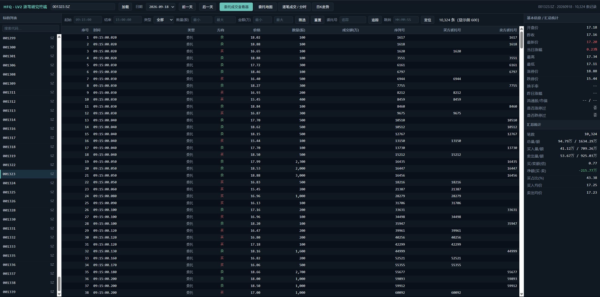
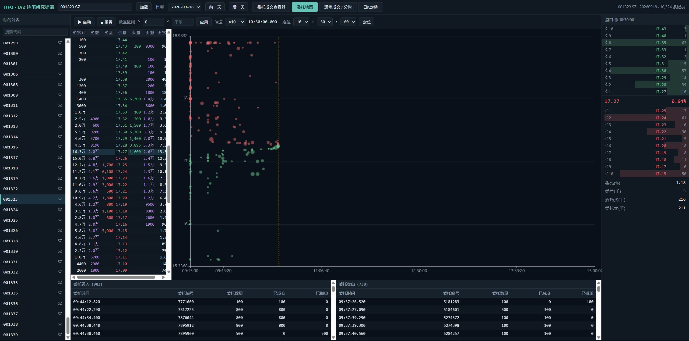
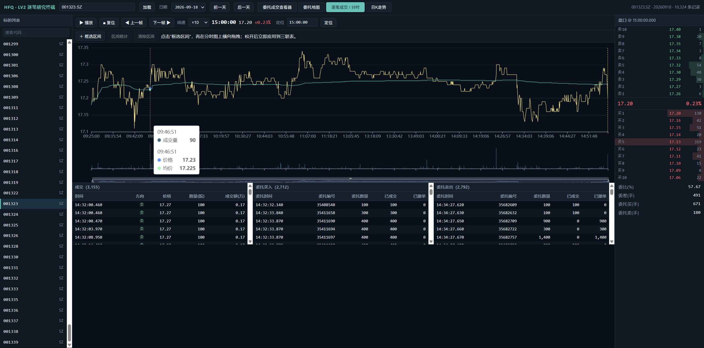
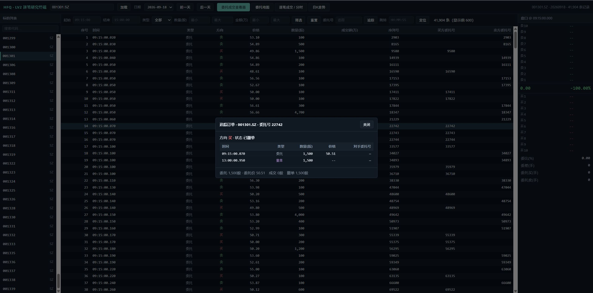

# hfq · LV2 逐笔研究终端

复现 `hfq/screenshot` 中「委托成交查看器」的 A 股 Level-2 逐笔数据回放/复盘工具。
设计规格见 [`SPEC_OPUS48.md`](SPEC_OPUS48.md)。

## 截图






## 数据源

本实现使用真实 **深交所 / 上交所 Level-2 逐笔行情**（万得 Wind CSV 格式）。
原始数据放在 `data-lv2/<交易日>.7z`（目前 **175 个交易日**，`20260105` … `20260921`，
每个归档含 7,600~7,900 只 SZ/SH 标的）。新增交易日只需把对应 `<YYYYMMDD>.7z` 放入
`data-lv2/`，服务启动时自动发现。

> 2026-01~06 的归档是「平铺」结构（`000001.SZ/行情.csv`），2026-06-30 起的是
> 嵌套结构（`20260921/000001.SZ/行情.csv`），且每行少一个尾部空列。两种布局都由
> `app/archive_layout.py` 统一处理，不要再按路径下标取代码。

**读取路径有两级，自动选择：**

1. **Parquet 列存**（zstd-3，按月/周分区，按 code 分片）。存在即优先使用：
   比原归档还小约 4%，随机访问快 2.3x，跨日日 K 只扫一个小文件。
2. 否则回退到 7z 归档按需抽取（归档目录见下）。

数据集位置按顺序自动探测，用第一个能打开的：

1. 环境变量 `HFQ_PARQUET_DIR`
2. **`D:\data-parquet`（唯一位置，840.5 GB / 22,607 个文件）**

> 2026-10-29：仓库内 `hfq/data-parquet/`（迁移前 C: 上的旧集，只有 2026-06~09 共 57 天、
> 278.1 GB）已删除，回收 C: 278.1 GB。它一度是候选列表的第 3 项，留着会让 `Store()`
> 和一批脚本在 D: 不可用时静默读到过期子集，所以从 `paths.PARQUET_CANDIDATES` 里也一并摘掉了。
> 要恢复那份数据只能从 7z 归档重建，别指望找到备份。

7z 归档目录同理：`HFQ_ARCHIVE_DIR` → 仓库内 `hfq/data-lv2/` → **`D:\data-lv2`（当前实际位置，874.3 GB）**。
两者可以分开放在不同盘；本机 2026-10-28 起两份都在 D:（C: 放转换临时目录）。

两级的交易日取**并集**，因此可以渐进迁移——只转一部分交易日也不会丢数据。
转换与校验见 [`docs/parquet-migration.md`](docs/parquet-migration.md)。

**当前状态：175/175 个交易日已全部转换为 Parquet（840.48 GB）。**

| 指标 | 结果 |
|---|---|
| 覆盖 | 20260105–20260921，175 个交易日，11,191 只标的，44 分片 |
| 体积 | 7z 874.3 GB / Parquet 840.48 GB（比 7z 小 1.04x），1,079.8 亿行 |
| 一致性 | 重建复核 57/57（48 个 vs 已验证旧数据集 + 9 个 vs 7z 原始解析）、HTTP 22/22 |
| 构建 | 4 进程并行 7.6 小时（19 天/小时），单日 263~280 s 解压 + 222~228 s 解析 |
| 跨日日 K | 175 天 `daily_kline` 285 ms（HTTP，缓存后） |
| 单只冷加载 | D: 上 1.0~2.3 s（机械盘，见文档 5.3 的取舍） |

> 「一致性」那行的旧数据集对照基准已于 2026-10-29 删除，现在只能靠 7z 原始解析复跑，
> 数字保留为当时的重建记录。

> 转换用 `scripts/build_parallel.py`（多进程 + manifest 短临界区 + 内存看门狗）；
> 单日重试用 `scripts/convert_all.py`。临时解压必须放快盘（C:），只把最终 Parquet 写 D:。

```powershell
# 并行转全部交易日（4 进程）；临时解压留 C:，输出写 D:
python scripts/build_parallel.py --root D:\data-parquet --workers 4 --max-commit 52

# 从 NAS 增量拉 7z（NAS 上 scp/sftp 都没开，只能走 ssh 裸流）
python scripts/fetch_lv2.py --workers 3
```

每只股票含三个 GBK 编码 CSV：
- `行情.csv` —— 十档盘口快照序列（分时/盘口来源）
- `逐笔委托.csv` —— 逐笔委托（含上交所撤单，类型 A=新增/D=撤单）
- `逐笔成交.csv` —— 逐笔成交（深交所撤单为成交代码 `C`）

价格单位为「元 × 10000」，时间为 `HHMMSSmmm`。深交所委托号（交易所委托号）与
成交编号共享同一 ApplSeqNum 序列，合并排序即得逐笔主表的精确时序。

> 数据质量提示：`16xxxx.SZ` 基金的部分 `行情.csv` 首帧把「成交量/成交额」写成了
> `2^64 - n` 形式的越界值。Parquet 数据集不收录这两列（应用也不消费），因此不受影响。

## 运行

```powershell
cd hfq
python server.py            # 默认 http://127.0.0.1:8770
```

依赖：`py7zr`（列归档成员）+ `7z` 命令行（解压；找不到时回退 py7zr）。仅本机监听。
首次加载某只股票（某交易日）会从对应归档抽取三个 CSV 到 `cache/<交易日>/<code>/` 并解析，
随后走内存缓存 +（按 交易日×代码 键的）列式二进制缓存 `cache/<交易日>/<code>/_cache_vN.bin`。

> 用 7z 命令行而不是 py7zr 解压：py7zr 1.1.3 在这类 3 万成员的单块归档上会把解压结果
> 整体堆进内存（实测虚拟内存 110+ GB，直接把 32 GB 内存的机器打到提交上限、桌面崩溃重启）。
> 可用 `HFQ_7Z` 指定 7z 路径。

环境变量：`HFQ_HOST`（默认 127.0.0.1）、`HFQ_PORT`（默认 8770）。

## 功能

| 面板 | 说明 |
|---|---|
| 委托成交查看器 | 逐笔主表（委托/成交/撤单）+ 时间/类型/数量(股)/金额(万) 区间筛选 + 委托号追踪 + 时间定位 + 汇总统计 + 基本信息 + 筛选记录（累计筛选日志）+ 多选行（Shift/Ctrl）右键统计选中范围 / 导出 CSV·TXT |
| 委托地图 | 时间×价格散点（绿买/红卖，气泡=委托量）+ 开市前显示盘前买/卖委托热力图，开市后按时间轴进度显示委托点（撮合成交/撤单的买卖委托点同时以涟漪动画消失）+ 左侧十档累积阶梯（每价位累计委托买/卖量与撤单量，叠加当前时刻十档队列）+ 回放引擎（启动/暂停/复位/倍速×1~×100）+ 键盘控制（空格 暂停/继续，←→ 拨动时间轴，↑↓ 调整倍速）+ 时间定位 + 底部委托买入/卖出明细（已成交/已撤单）|
| 逐笔成交/分时 | 分时价+均价+成交量 + 播放/暂停/复位/逐帧/倍速/时间定位 + 同步十档盘口 + 成交/委托买入/委托卖出三联明细 + 鼠标框选区间后自动过滤三联表并展示区间走势与统计 |
| 日K走势 | 跨全部已加载交易日的日 K（蜡烛 OHLC + 成交量），标注当前交易日；点击某日 K 线即切换到该交易日逐笔 |
| 交易日切换 | 顶栏「日期」下拉 + 前一天 / 后一天，按 交易日×代码 缓存，切换后基本信息/汇总/逐笔/地图/分时全部随之刷新 |
| 追踪订单 | 右键任意行或输入委托号 → 单委托号 委托→成交→撤单 生命周期 |
| 区间统计 | 点击「框选区间」后在分时图横向拖拽，松开即过滤三联表并弹出区间走势与涨幅/高低/成交量额/最大单笔/笔数；也支持主表多选行右键统计 |
| 导出 | 右键 → 导出选中（或全部）逐笔为 CSV / TXT |

## API

`GET /api/` 静态页面；JSON 接口（除 `dates` / `daily` 外均接受可选 `date=<YYYYMMDD>`，缺省取最新交易日）：
`health` · `dates` · `stocks?kw=&date=` · `basic?code=&date=` · `daily?code=`（跨日日K） ·
`events?code=&date=&start=&end=&type=&min_qty=&max_qty=&min_amt=&max_amt=` ·
`ordermap?code=&date=&min_qty=&max_qty=` · `orderbook?code=&date=&t=` · `ladder?code=&date=` ·
`books?code=&date=` · `intraday?code=&date=` · `trades?code=&date=&start=&end=` ·
`orders?code=&date=&side=&start=&end=` · `track?code=&date=&order_id=` ·
`locate?code=&date=&order_id=` · `region?code=&date=&start=&end=`

> `min_amt`/`max_amt` 单位为**万元**；委托类事件按名义额（价×量）计，成交类按实际成交额计。

## 已知限制

- 日 K 走势仅覆盖 `data-lv2/` 中已放入的交易日；日 K 的 OHLC 由当日十档快照派生（非官方日线）。
- 换手率 / 流通股 / 市值 需外部静态数据，本数据集不含，界面按占位显示 `--`（不臆造）。
- 个股名称不在数据内，列表以代码展示。

## 结构

```
hfq/
├── server.py              # 标准库 HTTP 服务 + 路由（多交易日感知）
├── app/data.py            # 交易日发现、读取调度、统一事件流、统计、订单追踪、日K
├── app/parquet_store.py   # Parquet 列存层（schema / 分区路由 / 列式读取）
├── app/archive_layout.py  # 归档布局解析（平铺/嵌套）+ 7z 命令行解压
├── app/paths.py           # 数据目录解析（环境变量 → D: → 仓库内）
├── scripts/
│   ├── build_parquet.py   # 7z -> Parquet 转换器（可断点续跑）
│   ├── build_parallel.py  # 多进程调度（槽位锁 + manifest 短临界区 + 内存看门狗）
│   ├── convert_all.py     # 单日看护器（逐日 + 重试 + 时间戳日志）
│   ├── fetch_lv2.py       # 从 NAS 增量拉 7z（ssh 裸流）
│   ├── verify_rebuild.py  # 重建复核（vs 旧数据集 / vs 7z 解析）
│   ├── snapshot.py        # 改动前快照（源码 + 数据清单 + 行为指纹）
│   ├── compare_snapshot.py / compare_sweep.py / verify_daily_kline.py
│   └── bench_*.py / scan_*.py
├── docs/parquet-migration.md
├── static/                # index.html / app.js / styles.css / vendor/echarts.min.js
├── cache/<交易日>/         # 7z 回退路径的按需抽取 CSV + 二进制缓存（自动生成）
├── data-parquet/          # 已删除（2026-10-29）；数据集现在只在 D:\data-parquet
├── snapshot/              # 迁移前快照与对比结果
└── data-lv2/*.7z          # 原始 7z 归档（已挪到 D:\data-lv2，仓库内为旧位置）
```
