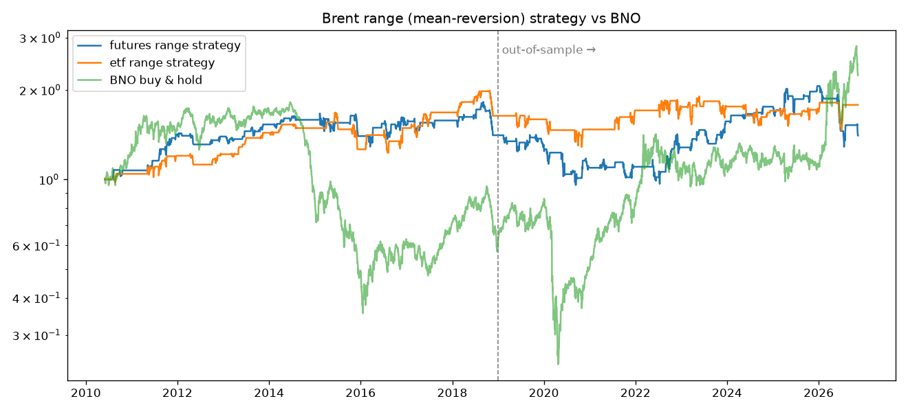
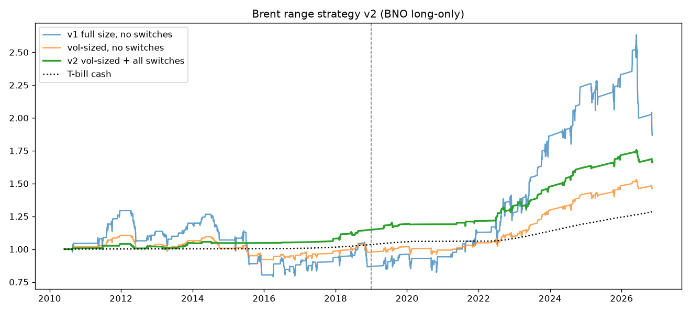

# Brent 区间（均值回归）策略

## 结论

- **全样本看 Brent 没有稳定的区间震荡特征**。短周期（≤20 日）接近随机游走，60 日尺度偏趋势（VR(60)=1.32，20 日收益自相关 +0.11）。
- BZ=F（Yahoo 近月拼接）上看到的轻微回归（VR≈0.97）**主要是换月跳空造成的假象**：跳空日用 BNO 修正后 VR 回到 ≈1.0。信号和收益一律用 BNO。
- 震荡是**阶段性**的：2016、2019、2021–2025 年 Hurst≈0.32–0.41；2014、2018、2020、2026 年是趋势/冲击年。区间策略在震荡年赚钱，在冲击年（2020 疫情、2026 霍尔木兹）做反方向会被重创。
- 震荡过滤（效率比 ER 低才开仓）在 IS 和 OOS 中都能稳定改善结果，但不足以把策略变成稳定正收益。
- 网格 432 组参数，IS 中位 Sharpe 为负；IS 与 OOS 排名几乎无关（期货 +0.14，ETF −0.03），即**参数选择不可迁移**。ETF 版 OOS 多数为正主要来自 2019 年后油价上涨的多头 beta，不是区间 alpha。
- 对照：60/120/200 日趋势跟随在 OOS 同样失败（Sharpe −0.2~0.1）。

## 选定参数的回测（IS=2010-06~2018，OOS=2019~2026-11）

| 版本 | 区间 | CAGR | Sharpe | MaxDD | 胜率 | 交易数 |
|---|---|---:|---:|---:|---:|---:|
| 期货多空 n=20,k=2,ER(40)<0.2 | IS | 4.1% | 0.36 | −23% | 72% | 53 |
| | OOS | 0.0% | 0.10 | −38% | 58% | 50 |
| ETF 只做多 n=40,k=1,ER(40)<0.2 | IS | 5.9% | 0.53 | −27% | 80% | 41 |
| | OOS | 1.1% | 0.15 | −23% | 54% | 41 |
| BNO 持有 | OOS | 18.6% | 0.62 | −72% | | |

## v2：BNO 单边 + 小仓位 + 事件/基本面开关（`strategy_v2.py`）

价格规则固定为 v1 网格中间值（n=20, k=1.5, ER(40)<0.3, stop_z=3, max_hold=20），不再挑最优。叠加：

| 开关 | 规则 | 触发占比 |
|---|---|---:|
| opec | OPEC+ 部长级/八国月度会议前 2 ~ 后 1 个交易日空仓（`events.py`） | 7.5% |
| gpr | GPR 地缘风险 7 日均值 > 过去 250 日 90 分位（滞后 5 日） | 11.3% |
| ovx | OVX > 过去 250 日 80 分位，或 5 日涨 > 20% | 19.3% |
| curve | 60 日展期收益（BNO − BZ=F 对数收益）≤ 0，即 contango 时不做多 | 30.5% |

仓位：10% 年化波动目标，单笔上限 50%（实际平均 34–45%）；空仓部分按 13 周国债（^IRX）计息，Sharpe 用超额收益。

| 配置 | IS 超额Sharpe | OOS 超额Sharpe | OOS CAGR | OOS MaxDD | OOS 交易 |
|---|---:|---:|---:|---:|---:|
| v1 满仓无开关 | −0.11 | 0.50 | 10.3% | −29.0% | 49 |
| + 波动率定仓 | −0.12 | 0.46 | 5.3% | −5.9% | 49 |
| + opec+gpr+ovx | 0.18 | 0.67 | 5.3% | −5.5% | 42 |
| + 全部开关（v2） | 0.57 | 0.56 | 4.8% | −5.5% | 40 |
| BNO 持有 | −0.09 | 0.56 | 18.6% | −72% | |

- 216 组价格参数上加全部开关：IS 中位超额 Sharpe −0.41 → +0.12（98% 改善），OOS +0.17 → +0.35（83% 改善）。开关的作用是稳健的，不依赖某一组参数。
- **v2 的 OOS 超额 Sharpe 与 BNO 持有相同（0.56）**：样本外并没有跑赢油价 beta 的风险调整收益，优势在于回撤 −5.5% vs −72%、以及 IS 期间（油价熊市）仍为正。OOS 仅 40 笔交易，t≈1.6，统计上不显著。
- OOS CAGR 4.8% 中约 2.7%/年是国债利息，策略本身超额约 2%/年。
- 未拦住的最大亏损：2026-06-12 ~ 07-01 冲击后急跌中抄底，BNO −19%，账户 −4.8%（仓位 24%）。
- 开关是在看过 v1 亏损年份（2020、2026）后设计的，阈值虽未调参，仍有设计层面的后视偏差。

## 工具选择

- **期货（BZ / ICE Brent）**：能做空，成本低，适合区间两端都做；但区间被突破时空头风险无上限，必须有硬止损（`stop_z`）。
- **ETF（BNO）**：只能做多（美股没有 1x 反向 Brent ETF；SCO 是 2x 反向 WTI，有杠杆损耗），费率 ~0.9%，近月滚动在升水期有损耗。适合"震荡市逢低买、回均线卖"的单边版本。
- USO 跟踪 WTI，不是 Brent。

## 文件

- `analyze.py [BZ_F|BNO]`：方差比、自相关、逐年 Hurst、z-score 分桶。
- `backtest.py`：策略、网格搜索（输出 `grid_futures.csv` / `grid_etf.csv`）、选定参数分年表现。
- `strategy_v2.py`：v2 消融、同仓位基准、分年、216 组参数稳健性（输出 `v2_daily.csv`、`v2_robustness.csv`、`equity_v2.png`）。运行：`uv run --with matplotlib --with pandas --with numpy python strategy_v2.py`。
- `events.py`：OPEC+ 会议日期（2026-06-07 为推断）。
- 执行假设：t 日收盘出信号、t+1 开盘成交；期货单边 3bp、ETF 单边 5bp；空仓不计利息。
- 数据：`data/*.csv`（yfinance：BZ=F、BNO、USO、^OVX、^IRX；GPR 来自 matteoiacoviello.com；2026-11-11 拉取）。
